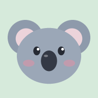
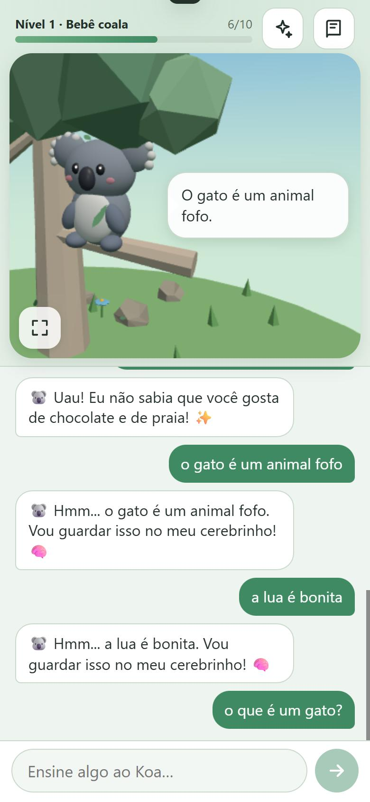
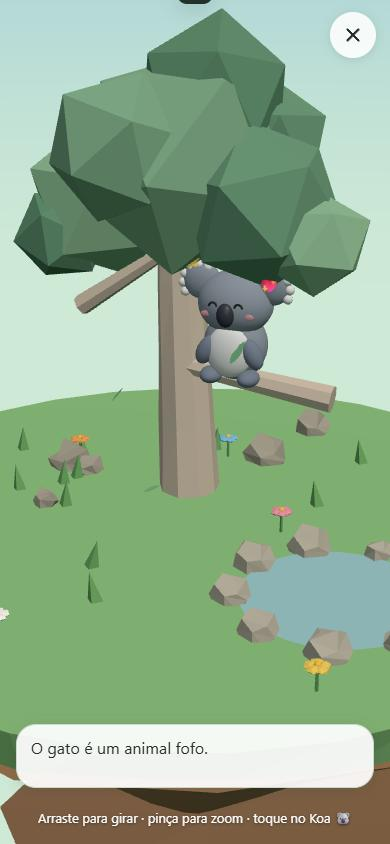
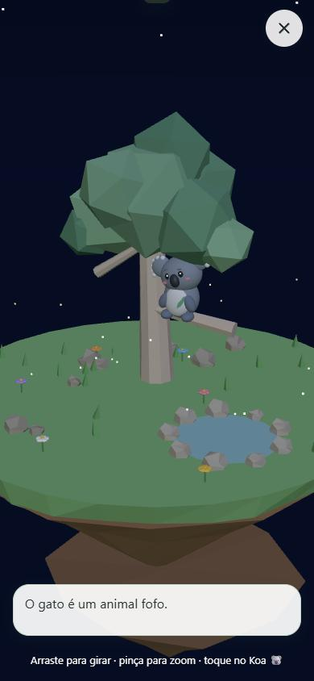

<div align="center">



# Koa 🐨

**Um coala que nasce sem saber nada e aprende tudo conversando com você.**

Web app em JavaScript puro, sem servidor e sem dependências para instalar, feito para o Safari do iPhone.

[](https://marcosfarias7.github.io/koa-ia/)


<br>

&nbsp;&nbsp;
&nbsp;&nbsp;


</div>

---

## ✨ O que ele faz

- 🧠 **Aprende conversando.** Entende frases como "o céu é azul", "meu nome é Ana" ou "eu gosto de chocolate" e guarda tudo na memória.
- 🤔 **Pergunta quando não sabe.** Se você perguntar algo novo, ele pede para você ensinar, e a próxima resposta vira conhecimento.
- ✏️ **Aceita correção.** "Não, na verdade é verde" atualiza o que ele sabia e ele agradece.
- 💬 **Pega o seu jeito de falar.** Aos poucos, passa a usar as expressões, as risadas e os emojis que você mais usa.
- 💭 **Pensa sozinho.** Liga os pontos: se "o gato é um animal" e "animal respira", ele conclui que o gato respira, sem ninguém ensinar.
- 🔎 **Responde ao contrário.** "Quem tem bigode?", "quem mia?", "o que é azul?": ele procura nas coisas que sabe.
- 🗨️ **Puxa assunto.** Se você fica quieta, ele lembra de algo que aprendeu, faz uma pergunta curiosa ou conta o que andou fazendo na ilha.
- 🐨 **Tem personalidade.** Gosta de eucalipto e soneca, tem medo de fogo, forma opinião sobre o que aprende e muda de humor com a hora e o dia.
- 🧮 **Faz contas e sabe as horas.** "Quanto é 2+3×4?", "que horas são?", "que dia é hoje?".
- 🏝️ **Vive a própria vida no mundo 3D.** Quando ninguém está conversando, ele desce da árvore, passeia, cheira flores, bebe água no laguinho e tira soneca à noite.
- 🌱 **Tem um mundo 3D que cresce.** Ele mora numa ilha flutuante com um pé de eucalipto. Nasce uma flor a cada coisa aprendida e uma borboleta a cada 10.
- 🌗 **O céu segue o relógio.** De dia é azul, no entardecer fica laranja e à noite aparecem estrelas e vaga-lumes.
- 🏆 **Sobe de nível.** Começa como "Bebê coala" e vai subindo aos 10, 25, 50, 100... aprendizados, com comemoração a cada nível.
- 📚 **Mostra o que sabe.** Numa tela própria dá para buscar, editar, apagar, exportar e importar a memória dele.
- 📱 **Vira app no celular.** Instala na Tela de Início do iPhone e funciona sem internet.
- ✨ **Tem um cérebro avançado opcional.** Com uma chave da API do Claude, ele fala de forma mais natural, mas continua usando só o que aprendeu com você.

## 🗣️ Como ensinar

| Você diz | O Koa aprende |
|---|---|
| `o céu é azul` · `gatos são animais` · `o gato tem bigode` | fatos sobre o mundo |
| `meu nome é Ana` · `minha cor favorita é verde` | coisas sobre você |
| `eu gosto de chocolate e pizza` · `eu moro em Curitiba` | seus gostos e sua vida |
| `você é fofo` | coisas sobre ele mesmo |
| `não, na verdade é verde` · `o gato não é preto, é branco` | correções |
| `esquece o gato` | apagar um assunto |

Depois pergunte: `o que é um gato?`, `qual é o meu nome?`, `do que eu gosto?`, `o que você sabe sobre mim?`. Ele também entende pequenos erros de digitação.

## 📲 Usar no iPhone

1. Abra **[marcosfarias7.github.io/koa-ia](https://marcosfarias7.github.io/koa-ia/)** no **Safari**.
2. Toque em **Compartilhar** (o quadrado com a seta) e depois em **Adicionar à Tela de Início**.
3. Pronto: o Koa abre em tela cheia, como um app, e funciona sem internet.

## 🔒 Privacidade

O Koa não tem servidor, então o que você ensina fica guardado só no seu aparelho. O botão **Exportar** cria um backup em `.json`.
O cérebro avançado é opcional. Quando você liga, as mensagens vão só para `api.anthropic.com`, e a chave nunca entra no backup.

## 🛠️ Como funciona por dentro

| Arquivo | O que faz |
|---|---|
| [`brain.js`](brain.js) | O cérebro: extrai fatos com regras em português, guarda a memória, faz busca aproximada (Levenshtein), trata correções, faz perguntas curiosas e aprende o jeito de falar da pessoa |
| [`world3d.js`](world3d.js) | O mundo 3D com Three.js: ilha, eucalipto, céu que muda com a hora, o coala 3D com as expressões e o jardim que cresce |
| [`koala.svg.js`](koala.svg.js) | O coala 2D em SVG, usado quando o 3D não está disponível |
| [`app.js`](app.js) | A interface: conversa, balão com efeito de digitação, níveis, tela de memória e ajuste ao teclado do iPhone |
| [`llm.js`](llm.js) | O cérebro avançado opcional, que chama a API do Claude |
| [`sw.js`](sw.js) | O service worker que faz o app funcionar offline |

## 💻 Rodar no computador

```bash
git clone https://github.com/MarcosFarias7/koa-ia.git
cd koa-ia
python -m http.server 8140      # depois abra http://localhost:8140
node tests/brain.test.js        # 56 testes do cérebro, sem dependências
```

---

<div align="center">
Feito com 💚 por <a href="https://github.com/MarcosFarias7">Marcos Farias</a>, com a ajuda do Claude Code.
</div>
